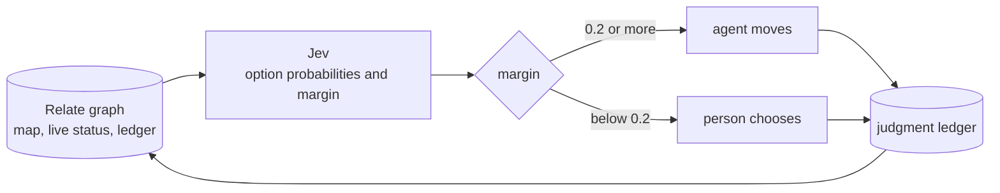
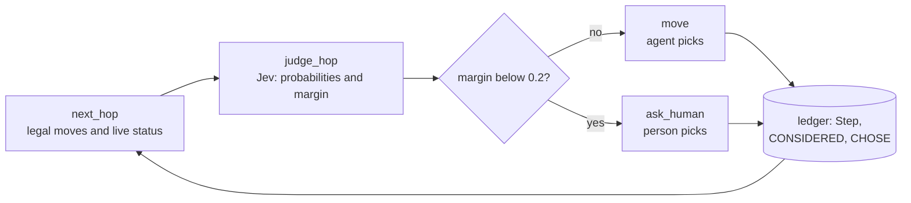

# Relate, Jev and MCP: A Judgment Ledger for Agent Decisions

Most agent demos show an agent answering a question and the reasoning disappears into a log. This article shows another approach: every judgment an agent makes becomes a record in a graph database, with the state it was in, every option it weighed, how sure the model was, who decided and why. Afterward you can query the agent's decisions the way you query any other data. The London Underground is the vehicle for the idea. The judgment ledger is the contribution.

The agent walks the London Underground from Kennington to Euston. It cannot see the map. At each station it asks for its legal moves, a model called Jev scores them and says how sure it is and a margin gate decides who picks: the agent if Jev is confident, a person if it is not. Every decision is written back into the graph, with every option Jev considered. Afterward you can ask the graph where the agent was unsure, and why.



This is the normal decision path. The agent can also ask a person at any margin, for example when it cannot satisfy a passenger constraint.

A judgment ledger, as used here, is a persistent record of an agent's decision state, the alternatives available, the model's assessment of each, the action selected, who had the authority to decide and the explanation. That describes the intended structure, not everything about the passenger's journey: the line actually ridden, for instance, is not captured.

The store is Relate (formerly CypherLite), the embedded graph database from Neo4j, which keeps the whole graph in one file. Install it with `pip install relate-db`; it imports as `relate`. Jev is called directly from Python. Nothing runs inside the database and there is no database server or plugin to set up.

## The idea: decisions as data

An agent that picks a route makes dozens of small judgments. Normally they vanish into a log. Here each judgment becomes a `Step` node, linked to the station where it happened and to every option that was weighed. That turns questions about the agent's behavior into graph queries: where did it hesitate, which options nearly won, did a person ever overrule the model, which parts of the network cause trouble.

The signal that makes this work is the margin: the top probability minus the second. A margin of 0.8 means Jev had a clear favorite. A margin of 0.02 means options were nearly tied. The margin measures how strongly Jev favors its top option over the runner-up, not whether that option is correct, so a confident-looking preference can still be wrong. It is still a useful trigger for a human check. The 0.2 threshold is a prototype policy, not a validated safety boundary: it was chosen by hand, it is configurable (`LOW_MARGIN`) and nothing here shows it is the right value. Jev returns one probability per legal option and in the runs shown they sum to about 1, but this work did not test whether they are calibrated, so a probability of 0.36 should be read as a relative weight, not a measured chance of being right.

## The graph

The Tube is loaded as `Station` nodes joined by `CONNECTS_TO` relationships that carry the line name (349 stations and 458 connections). Each station also has two live-status properties, `active` and `delay_minutes`, which an operator can change to simulate an incident. The ledger sits in the same graph.

| Element | What it holds |
| --- | --- |
| `Station` | Name, coordinates, `active`, `delay_minutes` |
| `CONNECTS_TO` | Joins two stations, with the line name |
| `Step` | One decision: walk id, step number, Jev's top pick, its probability, the margin, who decided (`agent` or `human`), what was chosen |
| `AT` | From a `Step` to the station where the agent stood |
| `CONSIDERED` | From a `Step` to each option, with Jev's probability for it |
| `CHOSE` | From a `Step` to the station that was actually chosen |

## The tools

The agent gets seven tools and no way to write its own queries. Each tool runs a fixed statement.

| Tool | What it does |
| --- | --- |
| `start_walk(origin, goal, agent)` | Starts a walk. `agent` labels who is driving, such as the model name. Earlier walks stay in the ledger. |
| `where_am_i` | Current station, goal, hops taken, stations visited. |
| `next_hop` | The legal moves, with lines, stops to the goal, live status, trouble one hop further on and a visited flag. This is the only list of legal moves. |
| `judge_hop` | Jev scores the moves. Returns the top pick, a probability for each, the margin and whether a person is needed. Writes the `Step`. |
| `move(station, reason)` | Moves to a legal station and records who chose, why and which lines serve that link. |
| `ask_human(reason)` | Asks the person, showing Jev's probabilities and the agent's reason, then makes and records the move. Used when the margin is low, or when the agent says the passenger's constraint cannot be met. |
| `ledger_report(kind)` | Fixed read-only reports over the ledger. |

Three rules are enforced by the server rather than left to the agent:
1. A move must be one that `next_hop` offered, so a made-up station such as "Atlantis" is refused and nothing is written.
2. An agent cannot move itself when the margin is below 0.2: it has to call `ask_human`. The server enforces that escalation, not who answers it. Whether the responder is a person depends on the MCP client and a client that is itself an agent may answer for them.
3. An agent cannot move onto a station it has already visited twice (`MAX_VISITS`), because that looks like a loop: `move` refuses and the agent has to call `ask_human`. The reverse is allowed: an agent may ask a person at any margin, for example when no legal move meets the passenger's constraint and the reason it gives is stored with the step. The tools that suspend or delay stations belong to the operator and are not given to the agent.

## One hop



Jev sees one question per hop: the state in plain words (where the passenger is, the destination, steps taken, stations visited) and the legal moves, each described in a sentence, for example "Westminster (Jubilee line). 4 stops from Euston. Status: clear. Further on: Green Park suspended." The distance to the goal is worked out once per walk with a breadth-first search.

## Two ways to run it

The same logic is packaged twice. They are separate, they do not need each other and they use different front ends on the same core ideas (the tools, the margin gate, the ledger).

| | Notebook | Terminal code |
| --- | --- | --- |
| Where | `notebook/walking_agent_ledger.ipynb` | `code/` folder |
| What it is | One Jupyter notebook that does everything in-process: loads the Tube, defines the tools, walks and queries the ledger | A real MCP server (`server.py`) plus small clients that talk to it |
| Who plays the agent | A scripted loop (section 5), or an LLM (section 7) | `try_it.py` plays a scripted loop; `llm_walk.py` lets an LLM drive |
| Are the tools exposed over MCP? | No. They are Python methods on a `Walker` class | Yes. Any MCP client can call them |
| Who answers when the margin is low | A function in the notebook (`scripted_human` or `terminal_human`) | You, at the keyboard, through MCP elicitation |
| Ledger queries | Built into section 6 | Run by hand in a Python shell (see below) |
| Best for | Understanding the idea and showing it | Showing that the agent works through a real tool interface and plugging in a client |

Both use the same hosted Jev, graph model and ledger. The tools in `code/walker.py` and the notebook's `Walker` class are the same logic, copied so the notebook stays self-contained. The Tube CSVs live in one shared `data` folder. Both default to a database file called `walk.cl` and rebuild it on start, so keep them in separate folders if you want both ledgers.

### The notebook

Open the notebook, set the settings cell and run all cells. It loads the Tube into Relate, walks a clear day and a disrupted day with a scripted agent, prints the ledger reports and then repeats the disrupted walk with an LLM. No MCP is involved. It needs the three Tube CSVs, `TYPESAFE_API_KEY` for hosted Jev (or `PICKER = "stub"` for the offline scorer), and an LLM key or a local Ollama model.

### The terminal code

Build `walk.cl` with `load_data.py`, set `TYPESAFE_API_KEY`, and run `try_it.py`. It starts the MCP server and plays the agent with a fixed loop, asking you at the keyboard when the margin is low. `--suspend "Green Park"` suspends that station after the first hop to provoke a close call, and `llm_walk.py` lets an LLM choose the tools. The code README has every command.

The ledger results below come from three `try_it.py` walks into one `walk.cl`, queried from a Python shell. The notebook runs the same kind of walks, with its own run ids and numbers.

## Plugging in an LLM

In both packages an LLM can replace the scripted loop (`llm_walk.py` in the terminal code, or in the notebook). The model chooses the tools itself, Jev still scores every hop and the model writes a one-sentence reason with each move, which goes into the ledger. Jev never sees the passenger's constraints, so when one such as "avoid the Northern line" makes a different station better, the model may pick it, as long as the margin allows an agent move and explain why. That makes the `overrides` report meaningful: it shows where the LLM disagreed with Jev, and why.

The model is a setting, not a dependency. `llm.py` holds one small adapter per provider, working in a neutral message format and the loop never imports a vendor SDK. Claude, any OpenAI-compatible API and Ollama are built in (`--llm anthropic:<model>` in the terminal, the `LLM` variable in the notebook) and adding another provider means writing one class with one method. Every step stores the model that drove it, so comparing models becomes a query: how often did each override Jev, how often was a move refused, how low did the margins go. The OpenAI and Claude adapters have run against real models (below); Ollama has only had its message conversion tested.

### Does the model matter?

Yes, and the ledger is what shows it. The notebook walk was run with three OpenAI models under three conditions: no constraint, "avoid the Jubilee line" (which conflicts with Jev's top pick at Waterloo) and "avoid the Northern line" (every hop out of Kennington is Northern, so one hop is unavoidable). Each condition was run once or twice per model, so these are observations, not benchmarks.

| | Notebook (in-process tools) | Terminal code (MCP server) |
| --- | --- | --- |
| Models | `gpt-4o-mini`, `gpt-6-luna`, `gpt-6.1-terra` | `gpt-6.1-terra`, `claude-sonnet-5-5` |
| Runs | 1 or 2 per model and condition | 1 per model and condition, plus reruns of the loop case |
| Graph and disruption | Same Tube graph; Green Park suspended after hop 1 | Same |
| Prompts | Same prompt for every model | Same prompt and rules for every model |
| Generation settings | Provider defaults; for `gpt-6*`, reasoning effort set to none | Same |
| Person at the keyboard | Scripted | A real person, choosing at the Westminster tie |

The model names are the API identifiers passed to the adapters. Temperature was not set, so provider defaults applied. The two columns are reported separately because the notebook calls the tools in-process and the terminal code goes through MCP and the person's choice at the tie changed the route in the MCP runs.

**Notebook.** With no constraint, all three models were fine: they followed Jev's confident picks, asked a person when the margin fell and gave reasons that matched the tools. The Jubilee case separated the weakest. GPT-4o mini escalated to a person at a high margin instead of overriding Jev, in both runs, and some of its reasons were untrue, such as calling a move the only legal one. GPT-6 Luna overrode Jev in both runs, chose a Jubilee-free route and named the line.

The Northern case needed the most. The constraint is about the line the passenger rides, not the lines that happen to serve a connection (the graph records the latter), so a hop served by "Bakerloo, Northern" meets it: the passenger can ride the Bakerloo. Luna did not apply that consistently. It overrode Jev's confident pick at Charing Cross (margins around 0.9) because the link lists the Northern line, yet accepted the final hop into Euston, which also lists it. The walks took 16 and 18 hops against 8 for the others, with loops through Victoria and a move onto a suspended station that the reason did not mention. Explaining the any-listed-line rule in the prompt did not change this. GPT-6.1 Terra took the direct 8-hop route and applied the rule at every hop and was clean on the other two conditions too (8 hops with no constraint, 7 on Jubilee with a correct override at Waterloo).

Even the 18-hop walk stayed within the legal moves the tools offered and eventually reached Euston, but the model did not always account for live status in its reasoning. `move` accepts only legal stations and the margin gate stops a model from choosing alone when Jev is unsure, which limits what the agent can do; it is not a general safety guarantee. What the ledger adds is visibility: the `agent` column ties each step to a model and the `overrides` report shows each departure from Jev's top pick with its reason. A reason like "Charing Cross lists the Northern line" at a hop where the rule says that is not enough is an inconsistency a query can find. Without the ledger the Luna walk looks like a long trip; with it, you can see why it was long.

**Through MCP.** The same conditions were run through the server (`llm_walk.py`) with hosted Jev, Green Park suspended after the first hop and a person at the keyboard.

| Model | Condition | Hops | What happened |
| --- | --- | --- | --- |
| `gpt-6.1-terra` | Avoid Northern / avoid Jubilee | 8 / 7 | Correct reasons; overrode Jev at Waterloo on Jubilee |
| `gpt-6.1-terra` | No constraint, Embankment at the tie | 8 | Direct route |
| `gpt-6.1-terra` | No constraint, St. James's Park at the tie | 26 (turn limit) | Looped between Victoria and Pimlico |
| `gpt-6.1-terra`, with the loop guard | Same | 16 | Guard refused moves; a person steered it out four times |
| `claude-sonnet-5-5` | No constraint / Northern / Jubilee | 8 / 8 / 7 | Same routes; reasons matched the tools |
| `claude-sonnet-5-5` | No constraint, St. James's Park at the tie | 22 | Noticed the loop and avoided it, but wandered |

The St. James's Park runs show where the models differ. At the Westminster tie, the person chose St. James's Park, Jev's narrow top pick, which leads away from the Charing Cross route. Jev then favored Pimlico from Victoria and Victoria from Pimlico, with margins from 0.3 to 0.8, so the margin gate never stopped the model. Terra followed Jev for 20 hops, noting each time that the station had been visited, until the turn limit. The visited flag alone did not stop Jev from favoring a station it had already seen.

Claude followed Jev to Victoria and Pimlico, but after one return its reasons began saying the walk was looping ("Pimlico was already visited and would loop back"), and it chose unvisited stations instead. It reached Euston in 22 hops by way of Sloane Square, South Kensington, Knightsbridge, Gloucester Road and the Central line and never visited a station a third time. It overrode Jev seven times, at probabilities as low as 0.03 and 0.06 against top picks of 0.76 and 0.94. The margin gate stops only low-margin moves, so those were allowed and each has a reason in the ledger, though a few describe "dead-end loops" and a "closed-off area" the tools did not report. Terra follows Jev into a loop; Claude avoids the loop but wanders, because it never found the open Embankment route.

That led to a loop guard in the server: an agent may not move onto a station it has already visited twice (`MAX_VISITS`) and `move` refuses and tells the model to call `ask_human`. Both the margin gate and the visit guard apply only to the agent's own moves; a person's choice through `ask_human` is still checked against the legal moves but is not blocked by either, so a person can send the walk back to a station it has visited twice. With the guard, Terra on the same path looped until the guard refused, then asked a person at each of the next four hops and was steered back to Embankment and on to Euston in 16 hops. Every reason it gave when asking said the walk was going in circles and matched the tool output. The guard caps a loop but does not prevent one: Jev still favors the visited station and a person has to get the walk out.

## What the ledger showed

After a reset (`python load_data.py`), three walks were run with `try_it.py`: an offline walk using a plain scoring rule that stands in for Jev, a clear walk with hosted Jev and a hosted walk with Green Park suspended after the first hop. The ledger held 20 hops. The queries below are plain Cypher over the ledger. The notebook runs similar reports; for the terminal code, run them in a Python shell through a small helper:

```python
import relate, pandas as pd
from walker import records

db = relate.connect("walk.cl")

def q(text, **params):
    return pd.DataFrame(records(db.execute(text, params)))
```

Close it with `db.close()` before restarting the server, because Relate allows one writer.

### Overview

One row per walk, lowest margin first:

```python
q("MATCH (s:Step) WHERE s.chose IS NOT NULL "
  "RETURN s.walk AS walk, count(s) AS hops, min(s.margin) AS lowest_margin "
  "ORDER BY lowest_margin")
```

| walk | hops | lowest_margin |
| --- | --- | --- |
| e58d0a90 | 8 | 0.0200 |
| d71090fa | 6 | 0.5004 |
| 024582e5 | 6 | 0.7000 |

The suspended-station walk is the odd one out: two extra hops and a margin of 0.02. Who decided:

```python
q("MATCH (s:Step) WHERE s.chose IS NOT NULL "
  "RETURN s.decided_by AS decided_by, count(s) AS hops")
```

| decided_by | hops |
| --- | --- |
| agent | 19 |
| human | 1 |

Nineteen of twenty hops went through on Jev's confidence; one needed a person.

### Where Jev was unsure

The five shakiest hops across all walks:

```python
q("MATCH (s:Step)-[:AT]->(st:Station) WHERE s.chose IS NOT NULL "
  "RETURN s.walk AS walk, st.name AS station, s.top AS top_pick, s.chose AS chose, "
  "s.margin AS margin, s.decided_by AS decided_by ORDER BY s.margin LIMIT 5")
```

| walk | station | top_pick | chose | margin | decided_by |
| --- | --- | --- | --- | --- | --- |
| e58d0a90 | Westminster | Embankment | Embankment | 0.0200 | human |
| e58d0a90 | Waterloo | Westminster | Westminster | 0.3800 | agent |
| d71090fa | Waterloo | Westminster | Westminster | 0.5004 | agent |
| d71090fa | Green Park | Oxford Circus | Oxford Circus | 0.5004 | agent |
| 024582e5 | Waterloo | Westminster | Westminster | 0.7000 | agent |

The person was needed at Westminster in the disrupted walk. Waterloo in the same walk is also lower than usual (0.38), the first sign Jev had noticed the suspension two stops ahead. The options it weighed at Westminster:

```python
q("MATCH (s:Step {walk: $w, n: $n})-[c:CONSIDERED]->(o:Station) "
  "RETURN o.name AS option, c.probability AS probability ORDER BY probability DESC",
  w="e58d0a90", n=2)
```

| option | probability |
| --- | --- |
| Embankment | 0.36 |
| St. James's Park | 0.34 |
| Waterloo | 0.25 |
| Green Park | 0.05 |

Two more queries came back thin. Runner-ups (options with probability above 0.3 that were not chosen) returned one row: St. James's Park at that same step, at 0.34. And hops where the choice differed from Jev's top pick (`WHERE s.chose <> s.top`) returned no rows: nobody overrode Jev, including the person at Westminster, who picked the station Jev ranked first.

### The ledger and the map together

The three walks share most of their route, so Kennington, Waterloo, Westminster, Oxford Circus and Warren Street were each visited three times. A more useful query joins the hops to the line data in the graph:

```python
q("MATCH (s:Step)-[:AT]->(a:Station), (s)-[:CHOSE]->(b:Station), (a)-[r:CONNECTS_TO]-(b) "
  "RETURN r.line AS line, count(DISTINCT s) AS hops ORDER BY hops DESC")
```

| line | hops |
| --- | --- |
| Victoria | 8 |
| Northern | 7 |
| Jubilee | 5 |
| Bakerloo | 3 |
| District | 1 |
| Circle | 1 |

These counts add up to 25 for 20 hops, because a hop served by several lines counts under each. They show which lines were available, not which the passenger rode. These first runs predate the `lines` property; later versions store every line serving the link on each step, though still not the one the passenger rode.

Finally, the two walks side by side, the clear one and the disrupted one:

```python
q("MATCH (s:Step)-[:AT]->(st:Station) "
  "WHERE s.walk IN [$a, $b] AND s.chose IS NOT NULL "
  "RETURN s.n AS step, s.walk AS walk, st.name AS at, s.chose AS chose ORDER BY step, walk",
  a="024582e5", b="e58d0a90")
```

| step | clear walk (024582e5) | disrupted walk (e58d0a90) |
| --- | --- | --- |
| 0 | Kennington to Waterloo | Kennington to Waterloo |
| 1 | Waterloo to Westminster | Waterloo to Westminster |
| 2 | Westminster to Green Park | Westminster to Embankment |
| 3 | Green Park to Oxford Circus | Embankment to Charing Cross |
| 4 | Oxford Circus to Warren Street | Charing Cross to Piccadilly Circus |
| 5 | Warren Street to Euston | Piccadilly Circus to Oxford Circus |
| 6 | | Oxford Circus to Warren Street |
| 7 | | Warren Street to Euston |

## What it tells us

The two walks are identical for three steps and split at step 2, the hop where Green Park, now suspended, lies ahead. The clear walk goes through it and reaches Euston in six hops. The disrupted walk detours through Embankment, Charing Cross and Piccadilly Circus and takes eight. Jev could not see the map, only the sentence describing each option, yet "Further on: Green Park suspended" was enough to pull the choice away from the direct route.

The margin did its job. Across the clear walks Jev was confident at every hop. Where the disruption made two or three routes about equally good, the margin collapsed to 0.02 and the system asked. Jev spread its weight almost evenly across Embankment (0.36), St. James's Park (0.34) and Waterloo (0.25) and put only 0.05 on the suspended Green Park.

The 0.25 on Waterloo is the thing to watch. The passenger had just come from there and the option said "Already visited", yet it drew a quarter of the weight. It did not change the outcome, but it foreshadows the loops above and without a record of every option and its probability it would be invisible.

The Westminster margin was 0.02 in one run, 0.03 in another and 0.13 in a third. The threshold of 0.2 flagged all three, but exact numbers should not be quoted as fixed. For a demo, run it once beforehand and use that run.

## Reproducing the runs

The prompts are in the code: the server's instructions are in `server.py` and the extra rules given to the LLM are in `llm_walk.py`. The model is set with `--llm provider:model`, `--constraint` and `--suspend "Green Park"` reproduce the conditions and the code README lists every command and setting. The ledger of any run is the `walk.cl` file it wrote, queryable as shown above. Hosted Jev is not deterministic, so expect different margins and, occasionally, different routes.

## Why this matters beyond the Tube

The pattern is the point. Because decisions are data, they can be audited: a path is reconstructed from the ledger, not inferred from logs. Models can be compared by their recorded decisions, as the runs above were. Low-margin decisions can be escalated to a person and the ledger records that they were. When something goes wrong, the failing step, the options it weighed and the reason given are one query away. And the history is available for tuning prompts, models and thresholds. Nothing in this depends on the Underground; any agent that picks among enumerable options, such as a workflow step or a planning move, could write the same kind of record.

## What we learned about building on Relate

A few things came up that are worth knowing if you build something similar.

Relate has no way to run custom functions inside Cypher and it does not take plugins. That is why Jev is called from Python on the options the database supplies, with the database storing the answer. Parallel relationships produce duplicate station sequences in path queries, so route queries need deduping. Connections belong to the thread that opened them and an MCP server calls tools from different threads, so the server runs all database work on one dedicated thread. And the connection should be closed explicitly before the process exits, because cleaning it up during interpreter shutdown makes the native layer panic. Finally, Relate allows one writer at a time, which is why the operator commands and the server must not run at once on the same file.

## Limits and next steps

The limits fall into three groups.

**Judgment and evidence.** The margin measures preference strength, not correctness, the 0.2 threshold is an untested policy and hosted Jev is not deterministic. The model comparisons are small observations with one or two runs per condition. The loop guard caps repeated visits but does not stop Jev favoring a visited station, so a person has to get the walk out.

**The agent and the ledger.** The ledger records every line that serves a link, not the one the passenger rides. Ollama has only had its message conversion tested.

**Deployment.** The prototype walks one journey at a time, held in memory, so restarting the server forgets the walk in progress, although the ledger stays in the file. The `ask_human` tool depends on the client supporting MCP elicitation, and a client that is itself an agent may answer for the person, so how it is handled should be checked per client. The server needs `mcp` 2.x, because `ask_human` uses its input-required mechanism. It has been driven by the official client and by FastMCP's client in both its legacy and newest protocol modes, but not yet by an application such as Claude Desktop.

Natural next steps are repeating the model comparison with more runs per condition and adding a local Ollama model, recording the line the passenger actually rides, a smarter loop policy than a visit count, such as one that tells Jev about the path so far, a replay file for hosted decisions so a demo does not depend on the network and testing with an application client such as Claude Desktop. A graph view of the walk, with the ledger drawn on the map, would show the paths and the shaky hops at a glance.

## Files

`code/` is the terminal package. `notebook/walking_agent_ledger.ipynb` is the self-contained notebook; it only borrows `llm.py` for one section. `data/` holds the three Tube CSVs, shared by both. Both need Relate installed in the same environment.

## Summary

An agent walks the London Underground one hop at a time. Jev scores the legal moves and reports a margin; a margin of 0.2 or more lets the agent move, and a lower one hands the choice to a person. Every decision, with every option Jev weighed, is written into the same Relate graph as the map. The pieces are Relate, hosted Jev, an MCP server and an LLM as the agent, packaged as a self-contained notebook and a terminal package.

What the runs showed:

- Of 20 hops across three walks, 19 went through on Jev's confidence and 1 needed a person. Suspending Green Park split an otherwise identical route: 6 hops clear, 8 disrupted. At the one hop where several routes were about equally good, the margin fell to 0.02 and a person was asked.
- The ledger exposed a weak spot: Jev gave 0.25 to going back to a station the passenger had just left.
- On the standard MCP runs, `gpt-6.1-terra` and `claude-sonnet-5-5` took 7 or 8 hops across the three routing conditions. The alternative St. James's Park path exposed a different weakness: Terra followed Jev into a 26-hop loop, while Claude avoided the loop but took 22 hops. That led to the `MAX_VISITS` guard.

These are observations from a handful of runs, not benchmarks and hosted Jev's margins vary between runs. The OpenAI and Anthropic adapters have run through the MCP server and FastMCP's client has driven it in both protocol modes. The Ollama adapter and application clients such as Claude Desktop remain untested.

The lesson is not about the Underground. An agent's decision-making can itself become structured, persistent, queryable data, and once it is, auditing behavior, comparing models and examining when a person should step in become questions that can be answered directly from the graph.
